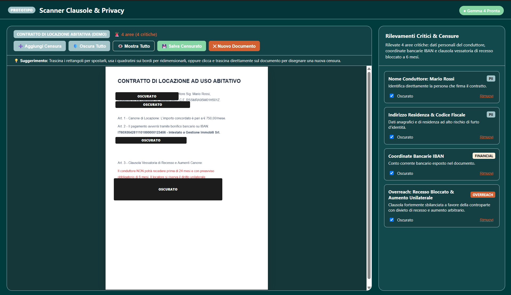
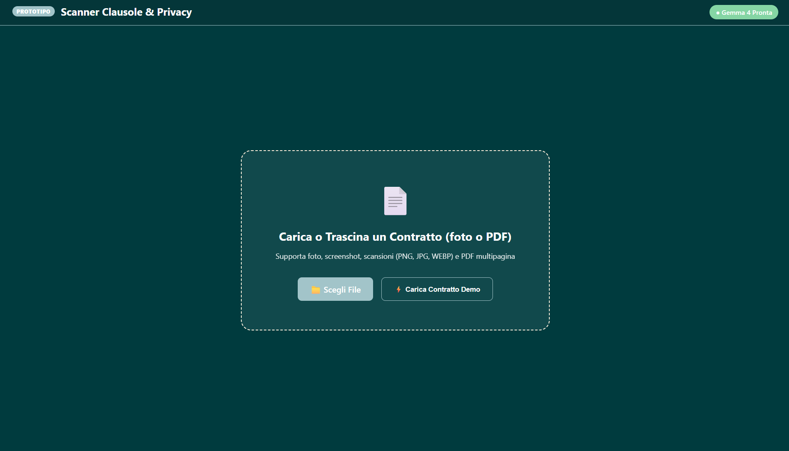
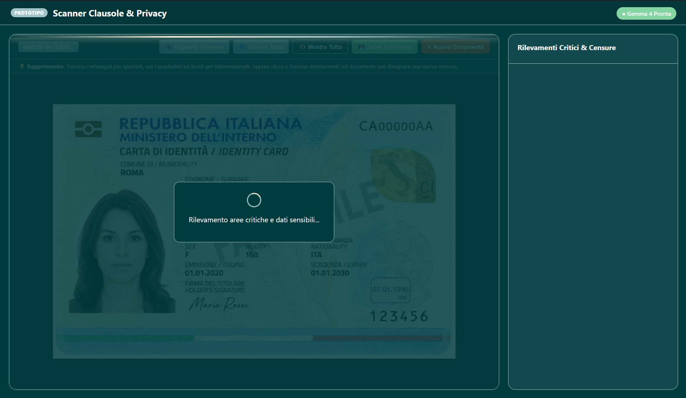
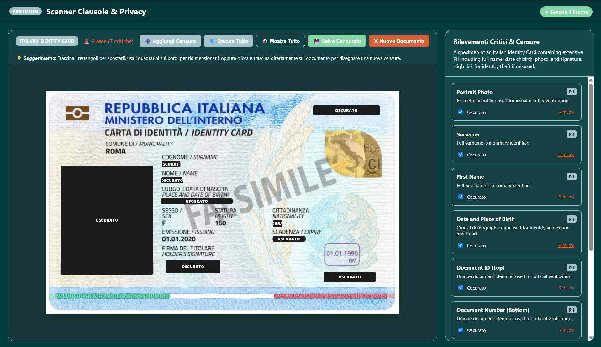
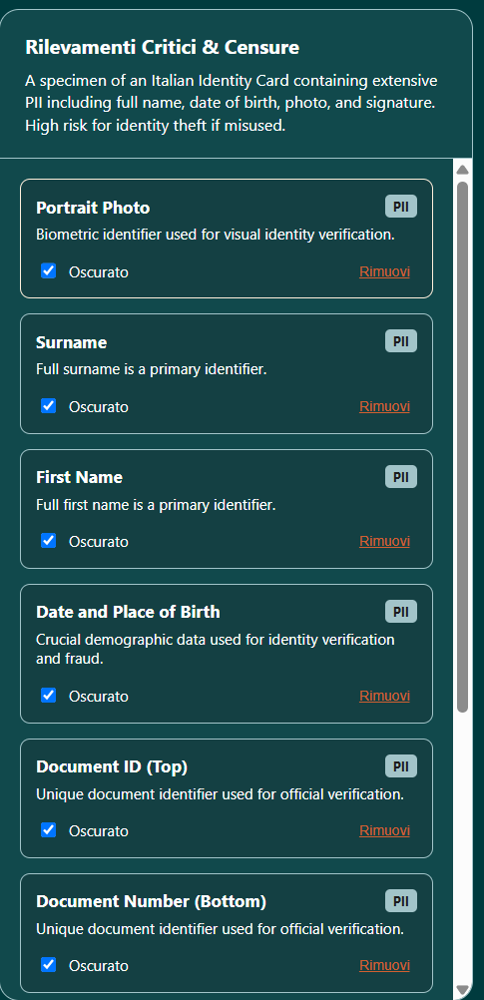

# ChiaroDoc 

> **Privacy-First, Context-Aware Contract Inspector & Redaction Engine powered by Gemma 4**  
> *Built for GDG Hackathon / Major League Hacking (MLH)*

---

## 📌 1. Goal of the Project

Every year, millions of students, young workers, and first-time renters sign critical documents—such as apartment leases, internship offers, gym memberships, and freelance NDAs. These documents present two major hazards:
1. **Predatory Overreach Clauses:** Landlords and employers often bury abusive terms in dense legalese (e.g., unilateral rent hikes, 2-year non-competes without compensation, or forfeiture of security deposits).
2. **Privacy & Identity Theft Risks:** When seeking advice from friends or online communities (such as Reddit or WhatsApp groups), sharing unredacted documents exposes sensitive Personally Identifiable Information (PII) like Tax Codes (Codice Fiscale/SSN), bank IBANs, home addresses, and private contact info.

### What We Implemented:
* **Custom Image Censoring:** Users can upload or snap a photo of a physical contract, screenshot, or scan (`.png`, `.jpg`, `.webp`). The AI visually detects sensitive areas and overlays interactive blackout masks directly over the text.
* **Custom PDF Censoring:** Full in-browser multi-page PDF ingestion (`.pdf`). Pages are rendered onto high-resolution retina canvases, analyzed by the vision model, and masked with pixel-perfect precision.
* **Context-Aware Flagging:** Unlike rigid keyword blockers, our system understands the *document context*:
  * In a **Rental Lease**, it isolates tenant names and IBANs for obscuring, while spotlighting excessive notice periods and arbitrary fee hikes.
  * In an **Employment Contract**, it flags salary details for privacy while warning about post-employment competition bans and personal IP ownership grabs.
* **Human-in-the-Loop Control:** The user is always in control. You can **Obscure All**, toggle individual items, or click **"Errore IA"** to discard AI hallucinations.

---

## 💻 2. Requirements & Dependencies

### System Prerequisites
* **Node.js:** `v18.19.0` or higher (`v20+` also supported).
* **Rust & Cargo:** Required to compile the Tauri desktop app (`cargo 1.80+`).
* **Linux System Libraries (Debian / Ubuntu / Pop!_OS):**
  Tauri requires native GTK3 and WebKit2GTK development libraries:
  ```bash
  sudo apt update && sudo apt install -y libwebkit2gtk-4.1-dev libgtk-3-dev libayatana-appindicator3-dev librsvg2-dev patchelf
  ```
  *(macOS requires Xcode Command Line Tools; Windows requires the Microsoft Edge WebView2 runtime).*

### Core Project Dependencies
* **Frontend:**
  * [`vue`](https://vuejs.org/) (`^3.5.13`): Vue 3 Composition API (`<script setup>`).
  * [`@google/genai`](https://www.npmjs.com/package/@google/genai) (`^2.31.0`): Google Gen AI SDK for multimodal Gemma 4 calls.
  * [`pdfjs-dist`](https://www.npmjs.com/package/pdfjs-dist) (`3.11.174`): In-browser Mozilla PDF.js rendering engine with dedicated web workers.
  * [`vite`](https://vitejs.dev/) (`^5.4.11`): Lightning-fast development server and module bundler.
* **Desktop Shell:**
  * [`@tauri-apps/api`](https://tauri.app/) (`^2`): Tauri 2 IPC and native window management.
  * `src-tauri` (Rust backend): Reads configuration and provides secure, air-gapped system bridges.

---

## 🔑 3. Hosting & Gemma 4 Configuration

This application uses **Gemma 4** (Google's open-weight multimodal vision model) as its inner intelligence engine. You can run the engine in two ways:

```
┌─────────────────────────────────────────────────────────────┐
│                      CHOICE OF ENGINE                       │
├──────────────────────────────┬──────────────────────────────┤
│ Option A: Cloud / API Mode   │ Option B: 100% Local Hosting │
│ • Zero local GPU required    │ • Complete offline privacy   │
│ • Requires Gemini API Key    │ • Uses local Ollama instance │
└──────────────────────────────┴──────────────────────────────┘
```

---

### Option A: Cloud / API Hosting (Recommended for Quick Testing)

If you do not have a dedicated GPU to run a 26B+ model locally, you can use the Google AI Studio endpoint for Gemma 4.

> **Note:** A valid **Gemini / Gemma API Key** is required for this mode.

#### Step-by-Step Setup:
1. Obtain a free API key from **[Google AI Studio](https://aistudio.google.com/app/apikey)**.
2. In the project root, edit (or create) the `src-tauri/.env` file:
   ```env
   GEMINI_API=your_actual_api_key_here
   ELEVEN_LABS_KEY=optional_for_future_voice_features
   ```
   *(Note: `src-tauri/.env` is excluded from git tracking to prevent accidental leakage).*
3. When launched, the application automatically invokes `my_get_api_keys` from Rust, initializes the GenAI client, and calls `gemma-4-26b-a4b-it` (with automatic fallback to `gemma-4-31b-it`).

---

### Option B: 100% Local Hosting (Zero-Cloud & Air-Gapped)

Because Gemma 4 is an **open-weight model**, you can run it entirely on your local machine with **no API keys, no internet connection, and zero external network traffic**.

#### Step-by-Step Setup:
1. **Install Ollama:**
   ```bash
   curl -fsSL https://ollama.com/install.sh | sh
   ```
2. **Pull and Run Gemma 4 Multimodal:**
   ```bash
   ollama run gemma4
   ```
3. **Verify Local Endpoint:**  
   Ollama will expose a local REST API at `http://localhost:11434/api/generate`.
4. In `src/App.vue`, point the request to your local Ollama port instead of the cloud client. In this mode, raw image pixels never leave your machine's RAM.

---

## 🎯 4. Why We Achieved Our Goal

1. **Beyond Basic Redaction ("Not a Paint Clone"):**  
   Existing redaction tools require users to manually locate and highlight text, or blindly blur everything. Our engine understands *legal context*: it automatically separates confidential identity data from actionable legal clauses.
2. **True Multimodal Support:**  
   Users are not limited to one file type. We achieved parity between paper snaps (camera photos) and multi-page digital PDFs using in-memory high-DPI canvas rasterization.
3. **Defense Against AI Hallucinations:**  
   We implemented human-in-the-loop verification. Every detected bounding box features category badges, context-specific explanations, and a one-click **"Errore IA"** button allowing users to reject false positives.
4. **Minimal & Decoupled Design:**  
   Clean separation between client rendering, AI inference, and human verification.

---

## 🖼️ 5. Showcase Zone: Images, Tests & Examples








---

### 🧪 Automated End-to-End Test Suite

We developed a headless browser test suite using the Chrome DevTools Protocol (`scratch/e2e.mjs` and `scratch/test_pdf_upload.mjs`) to verify all core operations:

| Test Case                   | Description                                                   |
| :-------------------------- | :------------------------------------------------------------ |
| **TC-01: Tauri IPC Bridge** | Retrieves API credentials from Rust backend into Vue context  |
| **TC-02: Canvas Rendering** | Generates mock contract and positions spatial bounding boxes  |
| **TC-03: Default Blackout** | Ensures sensitive PII boxes are obscured (`OSCURATO`) on load |
| **TC-04: Selective Toggle** | Unmasking a specific item maintains all other redactions     |
| **TC-05: Global Actions**   | "Mostra Tutto" reveals all; "Oscura Tutto" masks all          |
| **TC-06: Anti-Hallucination**| "Errore IA" immediately purges the box from the document      |
| **TC-07: In-Browser PDF**   | `pdfjs-dist` renders PDF page to canvas and extracts boxes    |
| **TC-08: Live Gemma 4 Scan**| Connects to `gemma-4-26b-a4b-it` and parses structured JSON   |

To re-run the automated tests locally:
```bash
npm run dev &
node scratch/e2e.mjs
```

---

## 🚀 6. Getting Started (Quickstart)

```bash
# 1. Clone the repository
git clone https://github.com/GAMinsect/GDGHackathonMLH-ydrom.git
cd GDGHackathonMLH-ydrom

# 2. Install dependencies
npm install

# 3. Configure API key
cp src-tauri/.env.example src-tauri/.env
# Add your GEMINI_API key inside src-tauri/.env

# 4. Run in development mode (Desktop Window)
npm run tauri dev

# Alternatively, run purely in the browser:
npm run dev
# Open http://localhost:1420
```

---

## 🔮 7. Roadmap & Next Steps

* [ ] **60-Second Voice Debrief:** Integration with the **ElevenLabs API** (using the key prepared in `.env`) to read aloud a 60-second conversational summary with 1x / 1.5x / 2x speed toggles.
* [ ] **Client-Side Export:** One-click generation of the finalized sanitized PDF using `pdf-lib` to burn permanent opaque rectangles over obscured text coordinates before sharing.
* [ ] **In-Browser WebGPU Inference:** Running ultra-compact quantized models (like Gemma 2B or SmolLM) directly via WebLLM for 100% offline mobile and browser execution with zero server overhead.

---

## 8. Credits

* **Massimo Nicastro** - Team Coordinator
* **Giacomo Consani** - Developer
* **Giuseppe Nozza** - Developer
* **Riccardo Scaletta** - Assistant
