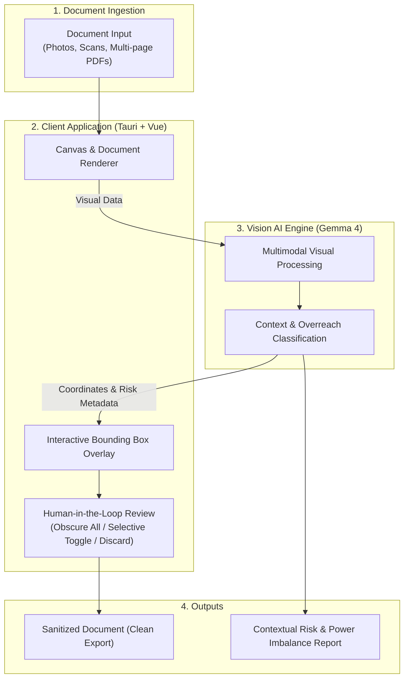

# High-Level Architecture Overview

A minimal, high-level architectural overview of the service, highlighting data flow and core components.

---

## Architecture Diagram

---

## Core Components

1. **Document Ingestion Layer:**  
   Accepts contract documents in heterogeneous formats (camera photos, screenshots, and multi-page PDFs) and normalizes them into high-resolution visual frames.

2. **Gemma 4 Vision Engine:**  
   Inspects document structure and semantics to detect:
   * **Context:** Document type (e.g., residential lease vs. employment agreement).
   * **Sensitive Information:** Personal identifiers, bank details, and compensation.
   * **Counterpart Overreach:** One-sided abusive clauses (non-competes, arbitrary price increases, penalty traps).

3. **Human-in-the-Loop Review Layer:**  
   Translates spatial coordinates into interactive on-document overlays, allowing the user to approve redactions, adjust selections, or dismiss false positives.

4. **Sanitization & Export Layer:**  
   Permanently obscures approved sensitive zones and generates a privacy-compliant file safe for public or community consultation.
